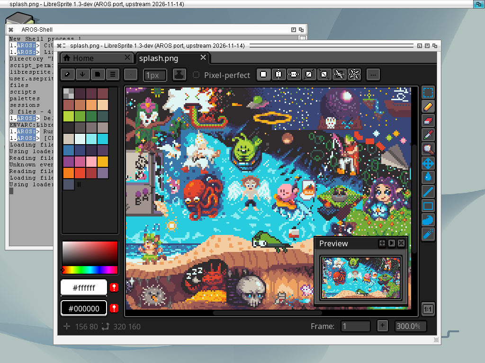
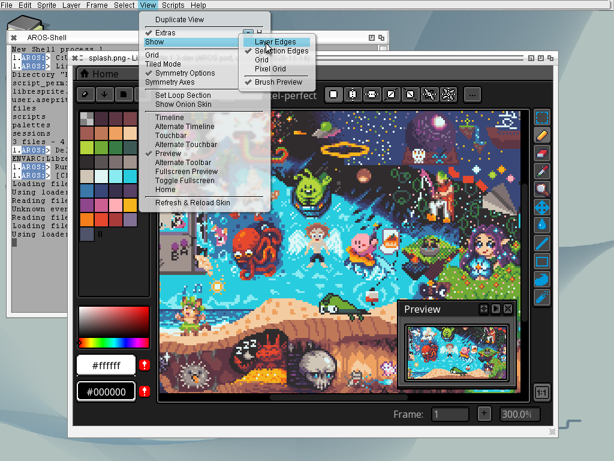
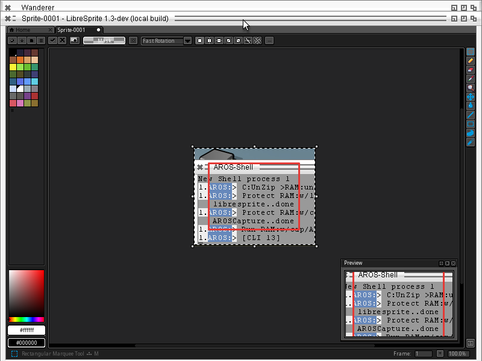
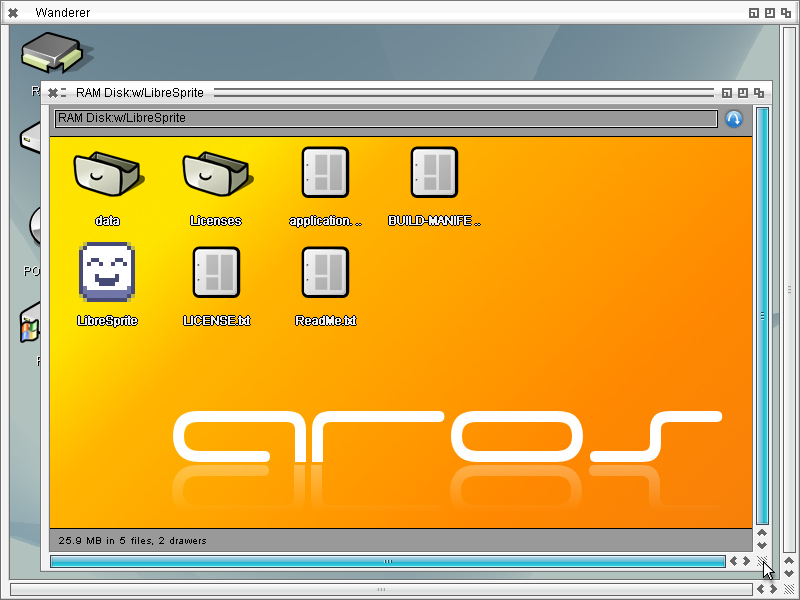

# LibreSprite for AROS

[LibreSprite](https://libresprite.github.io) is a free pixel art editor for sprites and
animations. This is a port to AROS of its development branch of 14 November 2026, which
uses SDL 3. It runs on x86_64 ABIv11 distributions, on mainline AROS x86_64 and on
mainline AROS for the Raspberry Pi.



## Features

LibreSprite has layers, animation frames with onion skin, palettes and a tiled mode for
repeating patterns. It opens and saves its own .ase format, PNG, GIF, BMP, ICO, PCX, TGA,
JPEG, QOI and FLI, and it exports sprite sheets.

The AROS version works with the rest of the system:

- The commands are in the window's menu bar (right mouse button over the title bar),
  with Amiga+letter shortcuts next to the usual Ctrl+letter ones.
- Copy and Paste exchange pictures with other programs as IFF ILBM. A screenshot copied
  in [AROS Capture](https://github.com/tomaszstaniak/aros-capture) pastes straight into a
  new sprite, and a copied selection opens in MultiView.
- File names may contain national characters from the system character set. On Polish
  and other national keyboards, AltGr types its characters in text fields.
- The iconify gadget leaves an icon on the Workbench. Pictures dropped on the window open
  as new documents, and a picture icon with LibreSprite as its default tool opens with a
  double-click.
- The window is drawn with OpenGL when gl.library is installed. The `GUI_RENDERER` tool
  type (`AUTO`, `GPU` or `CPU`) in the program icon changes that.





## Download

The archives are on the [releases page](https://github.com/tomaszstaniak/aros-libresprite/releases).

| System | Archive |
|---|---|
| x86_64, ABIv11 distributions | `libresprite-1.3.99.20261114-aros4-aros-x86_64-abiv11-pc.zip` |
| x86_64, mainline AROS (ABIv1) | `libresprite-1.3.99.20261114-aros4-aros-x86_64-abiv1-pc.zip` |
| Raspberry Pi, mainline AROS | `libresprite-1.3.99.20261114-aros4-aros-aarch64-abiv1-raspi.zip` |

A program built for one of these systems does not run on the others. With apkg:

    apkg install libresprite

## Installing

Extract the archive anywhere on a writable disk and keep the `data` drawer next to the
program. Start LibreSprite from its icon, or from a Shell in the `LibreSprite` drawer:

    LibreSprite Work:Pictures/hero.png

The program asks AROS for the 8 MB stack it needs, so the Shell's stack setting does not
matter. Settings, palettes and crash-recovery backups are kept in `ENVARC:LibreSprite`.



## Known limitations

- `fetch()` and the HTTP server are not available to scripts.
- The window's menu bar holds one level of submenus. Use the keyboard shortcuts for
  commands that sit deeper.
- Pictures copied to other programs lose their transparency (24-bit ILBM). Inside
  LibreSprite, copied pictures keep it.
- The file system functions for scripts handle ASCII file names only.
- Known issue: resizing the window very fast for a long time can leave LibreSprite
  unresponsive. Save your work first, and please report where it happens.
- All testing so far was in QEMU: AROS One 1.3, mainline nightly 2026-11-13 and the
  Raspberry Pi nightly 2026-11-10 (raspi3b). Reports from real computers are welcome in
  the [issues](https://github.com/tomaszstaniak/aros-libresprite/issues).

## Building

This repository holds the pinned upstream commit, the AROS patches and the scripts that
apply them, build the libraries LibreSprite needs and pack the release. LibreSprite's own
code is fetched from upstream. SDL 3 comes from
[aros-sdl](https://github.com/tomaszstaniak/aros-sdl). See
[Development](docs/development.md) and [Reproducing and saving changes](docs/patching.md).

```text
upstreams.json           LibreSprite URL and pinned commit
patches/libresprite/     AROS changes, applied in the order of series
patches/libarchive/      a change for libarchive's AROS build
scripts/                 bootstrap, deps, build, make-drawer, package and patch tools
packaging/               ReadMe.txt, licences and the apkg description of the package
cmake/                   AROS cross toolchain file
assets/icon/             Workbench icon descriptions
```

## Licence

LibreSprite is free software under the GNU General Public License, version 2. The patches
and scripts in this repository are under the same licence. The package lists the
libraries it includes and their licences in `Licenses/NOTICES.txt`.
